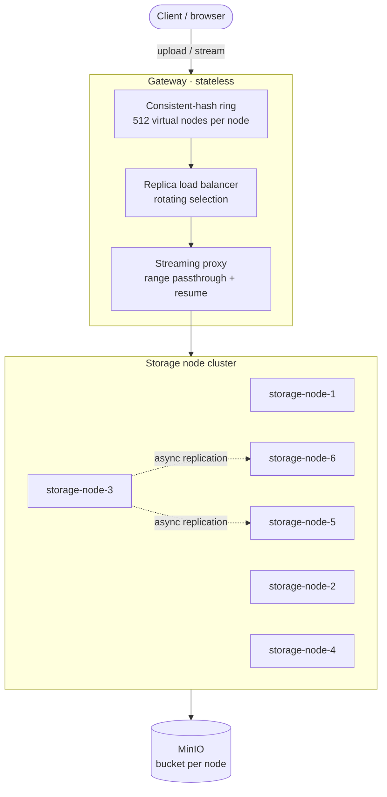

# Heimdall — Distributed Video Streaming & Load-Balancing API

A horizontally scalable video upload and delivery platform built as **three independently deployable
.NET services** on top of **MinIO** object storage. Videos are sharded across a cluster of storage
nodes using a **consistent-hashing ring with virtual nodes**, replicated asynchronously, and served
with **true streaming I/O** — including HTTP `Range` / `206 Partial Content`, so multi-gigabyte files
are seekable and never buffered in full by any process.

The whole thing runs as a real multi-process cluster: **8 containers** (6 storage nodes + gateway +
MinIO) via Docker Compose.

```bash
docker compose up -d --build
scripts/smoke-test.sh          # 23 end-to-end checks, including killing a node mid-download
open http://localhost:8090
```

---

## Table of contents

- [Why this exists](#why-this-exists)
- [Architecture](#architecture)
- [How it works](#how-it-works)
  - [Consistent hashing ring](#consistent-hashing-ring)
  - [Read path and load balancing](#read-path-and-load-balancing)
  - [Streaming and byte ranges](#streaming-and-byte-ranges)
  - [Failover](#failover)
  - [Replication](#replication)
  - [Authentication](#authentication)
- [Repository layout](#repository-layout)
- [Quick start](#quick-start)
- [Configuration](#configuration)
- [API reference](#api-reference)
- [Testing](#testing)
- [Design notes and trade-offs](#design-notes-and-trade-offs)
- [Roadmap](#roadmap)

---

## Why this exists

Most "video API" samples are a single process writing to a single disk or a single S3 bucket. That
hides every interesting problem: where does a given video live, what happens when the machine
holding it dies, and how do you serve a 4 GB file to a browser that wants bytes
1,200,000,000–1,200,065,535 without loading the whole thing into memory?

This project answers those questions explicitly, with **no central lookup table** and **no full-file
buffering** anywhere in the request path.

Two numbers from the live cluster, for calibration: relaying a 1 GiB download leaves the gateway at
**51 MiB** of resident memory, and a storage node that stored *and* served that same gigabyte peaks
at **86 MiB**. Those figures do not move with file size, because nothing in the path is proportional
to it.

---

## Architecture



Three deployable units:

| Service | Project | Role |
|---|---|---|
| **Gateway** | `src/Heimdall.Gateway` | Public HTTP surface. Owns the hashing ring, picks the primary for writes, load balances reads across replicas, handles failover and mid-stream resume, proxies byte ranges. Stateless — run as many as you like behind a VIP. |
| **Storage node** | `src/Heimdall.StorageNode` | Owns a slice of the keyspace. Writes chunks to MinIO, serves ranges back, pushes replicas to its successors. Identical binary, different identity via config. |
| **Shared library** | `src/Heimdall.Shared` | The hash ring, node descriptors, DTOs, range and chunk math, the node HTTP client, retry policy, API-key guard. Referenced by both services so routing logic can never drift between them. |

MinIO is the durable layer underneath. **Each node owns its own bucket** (`heimdall-node-{n}`), so a
replica is a genuinely separate copy of the bytes rather than a second pointer at one object, and a
node can be rebuilt from its bucket alone.

### Request flow

```
          POST /api/videos                         GET /api/videos/{id}
                 │                                   Range: bytes=8388607-8388609
                 ▼                                             │
        ┌──────────────────┐                                   ▼
        │     Gateway      │                          ┌──────────────────┐
        │                  │                          │     Gateway      │
        │ hash(id) ─► ring │                          │ hash(id) ─► ring │
        │   primary only   │                          │  ▼               │
        └────────┬─────────┘                          │ load balancer:   │
                 │ streamed PUT                       │ 60% of replicas, │
                 ▼                                    │ rotated, then    │
        ┌──────────────────┐                          │ the full chain   │
        │  node-3 (owner)  │                          └────────┬─────────┘
        │  chunk 0,1,2…    │                                   │ Range passthrough
        │  manifest last   │                                   ▼
        └────────┬─────────┘                          ┌──────────────────┐
                 │ async, retried                     │ node-6 (replica) │
          ┌──────┴──────┐                             │ chunk 0 tail +   │
          ▼             ▼                             │ chunk 1 head     │
     ┌─────────┐   ┌─────────┐                        └────────┬─────────┘
     │ node-6  │   │ node-5  │                                 │ 206 Partial Content
     └─────────┘   └─────────┘                                 ▼
                                                           3 bytes
```

---

## How it works

### Consistent hashing ring

Each physical storage node is projected onto a 64-bit ring as **N virtual nodes** (default **512**)
by hashing `"{nodeId}#{vnodeIndex}"`. A video's key is hashed with the same function; the owning
**primary** is the first virtual node clockwise from the key's position, and continuing clockwise
past tokens belonging to already-seen nodes yields the **preference list** (primary + replicas).

The hash is SHA-256 truncated to its first 8 bytes, big-endian. It must be identical in every
process and across every run, which rules out `string.GetHashCode()`.

Virtual nodes are what make the distribution usable. Measured over 120,000 keys on six nodes:

| Tokens per node | Worst node's deviation from an even share |
|---|---|
| 1 | 89% |
| 16 | 34% |
| 64 | 31% |
| 160 | 17% |
| **512** (default) | **5.5%** |
| 1024 | 2.7% |

512 is where the curve flattens, and 3,072 tokens for six nodes costs nothing to build or
binary-search. `GET /api/cluster/distribution?keys=50000` reports this against the live ring.

Adding or removing a node only remaps roughly `1/n` of the keyspace — and a unit test asserts the
stronger property that every key which moves when a node joins moves **onto the new node**, never
between two pre-existing ones.

Weights work too: a node configured `"Weight": 3` claims three times the tokens and owns roughly
three times the keyspace.

Crucially, **there is no lookup table**. The gateway computes ownership from the ring; so does every
storage node. Any process with the same node list reaches the same answer for the same key, so there
is nothing to coordinate and nothing to keep in sync. `deploy/cluster.json` — mounted read-only into
all seven .NET containers — is that shared input.

### Read path and load balancing

The ring says which nodes hold a video. The load balancer decides which to *ask*, and in what order:

1. Take the replicas (preference list minus the primary) and select
   `ceil(replicaCount × ReadReplicaPercentage / 100)` of them — 2 of 2 at the default 60%.
2. **Rotate the selection window per request**, so consecutive reads of one hot video land on
   different replicas. The counter is process-local: each gateway instance spreads its own traffic,
   with no shared state to coordinate.
3. Append the primary, then any unselected replicas.

Step 3 is the one that matters structurally: the returned list is always a **permutation of the full
preference list**, so it doubles as the failover chain and a read only fails once *every* holder has
been tried. At `ReadReplicaPercentage: 0` the primary goes first and replicas become pure failover;
at 100 the primary is reserved entirely for writes.

Every response reports what happened, which is how the routing stays observable:

```
X-Heimdall-Primary-Node:    node-3
X-Heimdall-Read-Candidates: node-6,node-5,node-3
X-Heimdall-Served-By:       node-5
X-Heimdall-Failover-From:   node-6
```

### Streaming and byte ranges

Nothing in the request path ever holds a whole video.

**Upload.** The request body is read as a stream and sliced into fixed-size chunks (default 8 MiB),
each pushed to MinIO as it fills. Memory is bounded by the chunk buffer, not the file size. The read
loop fills each chunk completely rather than trusting one `ReadAsync` — a network stream returns
short reads constantly, and an undersized chunk would silently corrupt every subsequent range
calculation. (A unit test feeds ingest 7 bytes at a time and asserts the stored chunks are still
exactly 8 MiB.)

A video becomes `{videoId}/chunk-00000 … {videoId}/chunk-NNNNN` plus `{videoId}/manifest.json`. The
manifest holds the length, chunk size, content type and a **SHA-256 of the full byte stream**,
computed on the way through during ingest — which is what lets the smoke test assert a download is
byte-identical to its upload, and what the HTTP `ETag` is derived from.

**The manifest is written last, deliberately.** Its presence is the commit marker: a node that dies
mid-ingest leaves orphaned chunks and no manifest, and reads for that id return 404 rather than a
truncated video.

**Download.** The gateway parses nothing — it passes `Range` through to the node, which maps it onto
chunk boundaries with integer math (`firstChunk = start / chunkSize`, `offsetInFirst =
start % chunkSize`, symmetric for the tail), fetches only the chunks that intersect the range, trims
the first and last, and pipes the result straight to the response body.

A correct `206 Partial Content` is returned with `Content-Range`, `Content-Length` and
`Accept-Ranges: bytes`, so `<video>` elements, ffmpeg and download managers can all seek. Supported
forms are `bytes=N-M`, `bytes=N-` and the suffix form `bytes=-N`; an over-long end is clamped, a
start past EOF gets `416` with `Content-Range: bytes */<length>` rather than a silent full body, and
a multi-range request falls back to a full `200` rather than inventing a `multipart/byteranges`
response.

### Failover

Reads fail over in two distinct places, because there are two distinct kinds of failure.

**Before the response starts.** Each candidate is tried in load-balancer order until one returns
usable headers. A connection refused, a DNS failure, a 5xx, or a wait for headers longer than
`Gateway:CandidateHeaderTimeout` all move on to the next holder. Nothing is written to the client
until a candidate has produced headers, which is the whole trick: a status line cannot be unsent, so
every failover decision has to happen while only headers are in hand.

A 404 from one node means "this replica has not caught up yet" and falls through to the next holder.
Only a 404 from *every* holder, with none of them failing, is reported to the client as 404 — if even
one node was unreachable the honest answer is 503, because its copy might be the one that has the
video.

**After the response starts.** The hard case: the node dies with the body half delivered. The status
line and `Content-Length` are already on the wire and cannot be revised — but they do not need to
be. What the client was promised is a specific absolute byte range, and any holder can supply the
unsent remainder: the gateway recovers its absolute file offset from the upstream `Content-Range`,
re-requests `bytes={position}-{end}` from the next candidate, and keeps writing into the **same**
response. The client sees one uninterrupted, complete body and never learns it came from two
machines.

Two details make this safe rather than merely clever:

- A resume candidate answering with `200` instead of `206` is **refused**. A 200 means "here is the
  file from byte zero"; appending that to what has already been sent would produce a corrupt body
  that still matched `Content-Length` — the worst possible outcome. The next holder is tried instead.
- The copy loop distinguishes "the node stopped sending" (resumable) from "the client stopped
  listening" (not), by pumping reads and writes separately instead of calling `Stream.CopyToAsync`.

A node that is SIGKILLed or partitioned away sends no RST, so a blocking socket read against it
never returns. `Gateway:RelayIdleTimeout` (15s) bounds the wait for upstream bytes so the resume
path can actually fire. It deliberately does *not* bound writes to the client — a paused player is
parked in a write, and should be able to idle indefinitely.

Verified live, not just in unit tests: `scripts/smoke-test.sh` starts a rate-limited download,
`docker kill`s the node serving it partway through, and asserts the delivered file is byte-identical
to the source.

```
Relay of resume-test-e6c3178f350a from node-5 broke at byte 32700862;
  resuming bytes=32700862-59999999 from node-3.
```

### Replication

After the primary has durably written all chunks *and* its manifest, it queues the video and a
background worker pushes it to the next `ReplicationFactor - 1` distinct physical nodes clockwise on
the ring — targets it derives itself from the video id, rather than being told. Replication is:

- **Asynchronous** — the upload response returns as soon as the primary is durable, so a client pays
  one write rather than three and a slow peer cannot hold a write hostage.
- **Over plain HTTP** — nodes talk to each other through the same internal API the gateway uses,
  which keeps one code path for reads and makes the system debuggable with `curl`.
- **Retried** with exponential backoff and full jitter (4 attempts by default). Each attempt opens a
  *fresh* chunk stream, because a partly-consumed HTTP request body cannot be resent, and each is
  bounded by `Node:ReplicationAttemptTimeout` so a vanished replica cannot park the worker forever.
  A target that already holds the video with a matching hash is skipped.
- **Authenticated** — every write and replication call carries `X-Heimdall-Key`.
- **Non-recursive** — replication traffic is marked `X-Heimdall-Replica-Write`, and a node receiving
  it does not re-replicate. Otherwise the cluster would gossip the same video around the ring
  forever.

Targets are pushed concurrently, since the copies are independent and replica latency is otherwise
additive. `GET /internal/replication/{videoId}` on any node reports per-target state and attempt
counts.

The trade-off of asynchrony is a window in which only the primary has the video. A read that load
balances onto a not-yet-caught-up replica gets a 404 from it and falls through — which is exactly why
the proxy treats a single 404 as "try the next holder".

### Authentication

Writes (upload, replication, delete) require `X-Heimdall-Key`, compared in fixed time so a wrong key
leaks nothing through response timing. Reads are open, because the point of the service is for a
`<video>` element to be able to play — put user-facing auth at the gateway's edge.

If no key is configured, the write paths return **503 rather than running unauthenticated**. Unset
means disabled, not open.

---

## Repository layout

```
.
├── src/
│   ├── Heimdall.Gateway/              # public API, ring, load balancer, failover, resume
│   │   ├── Endpoints/                 # VideoEndpoints, ClusterEndpoints
│   │   ├── Proxy/VideoStreamProxy.cs  # candidate walk, range passthrough, mid-stream resume
│   │   ├── Routing/                   # VideoUploadService (streaming + multipart), VideoId
│   │   └── wwwroot/index.html         # browser console: upload, seek, see the routing
│   ├── Heimdall.StorageNode/          # chunked write/read against MinIO, replication
│   │   ├── Endpoints/VideoEndpoints.cs
│   │   ├── Storage/                   # IObjectStore, S3ObjectStore, ChunkedVideoRepository
│   │   └── Replication/               # ReplicationQueue, ReplicationWorker
│   └── Heimdall.Shared/               # one implementation of everything both sides need
│       ├── Cluster/                   # ConsistentHashRing, ReplicaLoadBalancer, ClusterTopology
│       ├── Streaming/                 # ByteRange, RangeHeader, ContentRange, ChunkMap
│       ├── Http/                      # StorageNodeClient, RetryPolicy, routes
│       ├── Contracts/                 # VideoManifest, UploadResult, headers
│       └── Security/ApiKeyGuard.cs
├── tests/Heimdall.Tests/              # 162 xUnit tests
├── deploy/
│   ├── cluster.json                   # the shared node list, mounted into all 7 containers
│   ├── gateway.Dockerfile
│   └── storage-node.Dockerfile
├── scripts/smoke-test.sh              # 23 end-to-end checks against a running cluster
├── docker-compose.yml                 # 8 services
└── Heimdall.sln
```

---

## Quick start

```bash
docker compose up -d --build            # 8 containers; nodes wait on MinIO's health check
docker compose ps                       # all should report (healthy)

scripts/smoke-test.sh                   # upload, replicate, range, fail over, resume, delete
```

Then open <http://localhost:8090> for the browser console: pick a video file, upload it, and watch
which node serves each read. Or by hand:

```bash
# upload (raw body - the browser, curl and the gateway all stream it)
curl -X POST "http://localhost:8090/api/videos?fileName=film.mp4" \
     -H "X-Heimdall-Key: dev-heimdall-key" \
     -H "Content-Type: video/mp4" \
     --data-binary @film.mp4

# {"videoId":"film-71929383cc33","length":1073741824,
#  "contentHash":"20dc30…","primaryNodeId":"node-3",
#  "replicaNodeIds":["node-6","node-5"],"streamUrl":"…"}

# seek 1 GiB in
curl -r 1073740800-1073741823 \
     http://localhost:8090/api/videos/film-71929383cc33 -o tail.bin

# see the routing decision without moving any bytes
curl -I http://localhost:8090/api/videos/film-71929383cc33

# ask the ring where an id would land, contacting no node at all
curl http://localhost:8090/api/cluster/placement/film-71929383cc33
```

Watch failover with your own eyes:

```bash
docker compose stop storage-node-3                      # kill a holder
curl -I http://localhost:8090/api/videos/film-71929383cc33 | grep -i heimdall
docker compose start storage-node-3
```

Host ports: gateway **8090** (override with `HEIMDALL_GATEWAY_PORT`), storage nodes **8101–8106**,
MinIO API **19000**, MinIO console **19001** (`heimdall` / `heimdall-secret`).

Building locally without Docker needs the .NET 9 SDK: `dotnet build && dotnet test`.

---

## Configuration

`deploy/cluster.json` is mounted read-only into all seven .NET containers — the shared input that
replaces a coordinator:

```json
{
  "Cluster": {
    "ApiKey": "dev-heimdall-key",
    "VirtualNodesPerNode": 512,
    "ReplicationFactor": 3,
    "ReadReplicaPercentage": 60,
    "Nodes": [
      { "Id": "node-1", "BaseUrl": "http://storage-node-1:8080", "Weight": 1 }
    ]
  }
}
```

| Setting | Default | What it does |
|---|---|---|
| `Cluster:VirtualNodesPerNode` | 512 | Tokens per unit of weight. See the table above. |
| `Cluster:ReplicationFactor` | 3 | Holders per video. Clamped to the cluster size. |
| `Cluster:ReadReplicaPercentage` | 60 | Share of replicas placed ahead of the primary for reads. |
| `Cluster:ApiKey` | — | Shared secret for writes. Unset disables them. |
| `Node:Id` | — | Must appear in `Cluster:Nodes`; the ring hashes this string. |
| `Node:ChunkSizeBytes` | 8 MiB | Larger chunks mean fewer object-storage round trips per seek. |
| `Node:ReplicationMaxAttempts` | 4 | Attempts per target before the copy is abandoned. |
| `Node:ReplicationAttemptTimeout` | 10 min | Ceiling on one whole-video replication attempt. |
| `Gateway:CandidateHeaderTimeout` | 10 s | Give up waiting for a node's *headers* and try the next. |
| `Gateway:RelayIdleTimeout` | 15 s | Abandon a silent node mid-body and resume elsewhere. |
| `Gateway:ProxyBufferBytes` | 128 KiB | Relay buffer size. |

Per-service settings come from environment variables in `docker-compose.yml`; anything in
`appsettings.json` can be overridden with the usual `Section__Key` form.

A storage node **refuses to start** if its `Node__Id` is absent from `Cluster:Nodes` — the ring
hashes ids, so a mismatch means the process would own no keyspace, and failing loudly beats quietly
running a node nobody routes to.

---

## API reference

### Gateway — `http://localhost:8090`

| Method | Path | Notes |
|---|---|---|
| `POST` | `/api/videos?fileName=x.mp4` | Upload. Raw body or `multipart/form-data` (first file part, located with a streaming `MultipartReader`). Returns id, length, hash, placement, stream URL. **Key required.** |
| `PUT` | `/api/videos/{id}` | Upload with an explicit id. **Key required.** |
| `GET` | `/api/videos/{id}` | Stream. Honours `Range` → `206`. |
| `HEAD` | `/api/videos/{id}` | Length, `ETag` and routing headers; no bytes moved. |
| `GET` | `/api/videos/{id}/manifest` | Manifest from the first reachable holder, plus placement. |
| `DELETE` | `/api/videos/{id}` | Remove from every holder. **Key required.** |
| `GET` | `/api/cluster` | Nodes, token count, replication factor, measured keyspace shares. |
| `GET` | `/api/cluster/health` | Live probe of every node. |
| `GET` | `/api/cluster/placement/{id}` | Where an id routes — answered from the ring, contacting nothing. |
| `GET` | `/api/cluster/distribution?keys=N` | Hash N synthetic keys through the real ring and report the spread. |
| `GET` | `/api` | Endpoint index. |
| `GET` | `/health` | Liveness. |

### Storage node — `http://localhost:810{1..6}`

| Method | Path | Notes |
|---|---|---|
| `PUT` | `/internal/videos/{id}` | Streaming ingest → chunks + manifest. **Key required.** |
| `GET` / `HEAD` | `/internal/videos/{id}` | Range-aware read straight out of chunks. |
| `GET` | `/internal/videos/{id}/manifest` | 404 when this node does not hold it. |
| `DELETE` | `/internal/videos/{id}` | **Key required.** |
| `GET` | `/internal/replication[/{id}]` | Per-target replication state and attempt counts. |
| `GET` | `/internal/node` | Id, bucket, chunk size, this node's keyspace share. |
| `GET` | `/health`, `/ready` | `/ready` probes the bucket. |

---

## Testing

```bash
dotnet test                 # 162 unit tests, ~1s
scripts/smoke-test.sh       # 23 end-to-end checks against the running cluster
```

The unit tests target the places where a subtle error would be invisible in a demo and corrupting in
production.

**Hashing** — that the hash is the documented SHA-256 construction; that two independently
constructed rings agree on placement across thousands of keys (the property that lets gateway and
nodes route without talking); that the keyspace lands within 10% of even and that more tokens
monotonically improve it; that adding a node moves ~1/N of keys and moves them *only onto the new
node*; that removing one remaps only what it owned; that weights scale ownership; and that keys
hashing past the final token wrap to the first.

**Load balancing** — selection-size arithmetic at every percentage (including that a non-zero
percentage never rounds down to zero replicas); that candidates are always a permutation of the
preference list, so no holder is dropped from the failover chain or retried twice; that rotation
distributes first-choice reads *exactly* evenly; that a negative rotation counter does not throw;
and that a replica never believes it owes replication to anyone.

**Byte-range math** — every single-range header form including suffix ranges, clamping, 416, and
multi-gigabyte offsets; plus an exhaustive check that *every* `(from, to)` pair over a 50-byte object
decomposes into contiguous chunk slices whose lengths sum exactly.

**Chunked storage** — round-trip byte-identity at every boundary case (empty, one byte, exactly one
chunk, one byte over, exact multiples, ragged tails); that the ingest hash is the plain SHA-256 of
the input; that a seek near the end of a 1,000-chunk video issues one chunk read rather than a
thousand; and that chunk boundaries stay exact when the source dribbles 7 bytes at a time.

**Failover** — a dead first candidate; a chain walked to its last member; a replica that has not
caught up; a node returning 500; 404-everywhere (→ 404) versus a mix of 404 and unreachable (→ 503);
and a range request that fails over mid-seek still returning the exact right slice.

**Mid-stream resume** — a node that sends 20,000 of 60,000 bytes and then drops, with the response
completed from another holder and compared byte for byte at the seam; that the resume names the
correct absolute offset; that a resumed *range* request stays inside the client's requested window
rather than the whole file; that a holder answering a resume with `200` is refused rather than
concatenated; and that an unresumable truncation is reported honestly instead of claimed as success.

The end-to-end script uploads a random file, polls for replication to land on all three holders,
compares the download bit for bit, checks five byte ranges against the source (one of them
straddling a chunk boundary), stops the node that just served a read and confirms the next holder
returns identical bytes, then **SIGKILLs a node mid-download** and asserts the delivered file is
still byte-identical.

---

## Design notes and trade-offs

**Writes are primary-only; reads are not.** An upload goes to the one node the ring says owns it. The
upload body is a one-shot stream, so there is nothing to replay if that node is down — the gateway
returns 503 and the client retries against the same (stable) owner. Reads *can* be retried, so they
fail over freely. Accepting a write on a non-owner would mean either buffering the whole upload or
leaving a copy somewhere the ring will never look for it.

**No health tracker.** An earlier design had the gateway mark nodes unhealthy with a decaying
penalty. It was dropped: a 2-second `ConnectTimeout` makes a dead node cost ~2 s once per request,
per-request failover is already correct without shared state, and a stale health verdict is its own
source of bugs. Reintroducing it is a throughput optimisation, not a correctness fix.

**Reads rotate instead of pinning.** Selecting replicas deterministically per `videoId` would keep
page cache and MinIO read-ahead warm on one node per video. Rotating spreads load instead. Rotation
is the right default for the stated goal — spreading traffic — and `ReadReplicaPercentage` is the knob
between the two: lower it to concentrate reads on fewer, warmer nodes.

**The manifest is the commit marker.** Writing it last means a crashed ingest is invisible rather
than half-readable. It also means the manifest is the single source of truth for chunk size, so a
node can serve videos written under a different `ChunkSizeBytes` than it is currently configured
with.

**One MinIO instance.** Each node owns a separate bucket, so a replica is a real second copy of the
bytes — but they share a storage backend. This demonstrates cluster topology and placement, not
independent failure domains.

---

## Roadmap

Honest about what is out of scope for a single-author project:

- **Anti-entropy.** If a replication target stays down past its retry budget, the copy is simply
  missing; nothing later notices and repairs it. Real systems run a Merkle-tree or hinted-handoff
  repair pass.
- **Rebalancing on topology change.** The ring reshuffles correctly when `cluster.json` changes, but
  existing videos are not migrated to their new owners, so they become unreachable until copied.
- **Delete is best-effort.** A node that is down keeps its copy and will serve a deleted video when
  it returns.
- **Orphaned chunks.** Re-uploading a shorter video over a longer one leaves the extra chunks behind.
  They are unreachable — the manifest bounds every read — but they do occupy space until swept.
- **Transcoding, HLS/DASH packaging, CDN offload.** Heimdall serves the bytes it was given; it does
  not produce renditions or manifests for adaptive bitrate.
