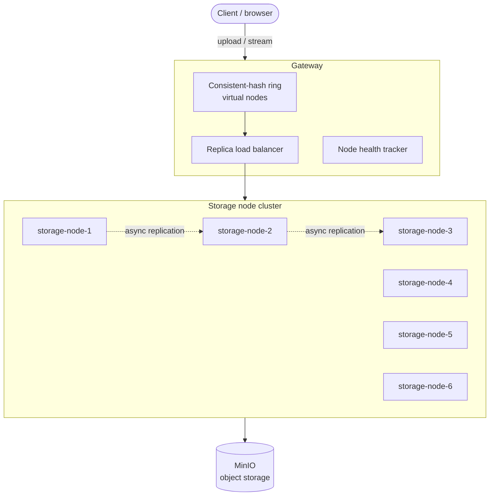

# Distributed Video Streaming API

A horizontally scalable video upload and delivery platform built as **three independently deployable .NET services** on top of **MinIO** object storage. Videos are sharded across a cluster of storage nodes using a **consistent-hashing ring with virtual nodes**, replicated asynchronously, and served with **true streaming I/O** — including HTTP `Range` / `206 Partial Content` support, so multi-gigabyte files are seekable and never buffered in full by any process.

The whole thing runs as a real multi-process cluster: **8 containers** (6 storage nodes + gateway + MinIO) via Docker Compose.

---

## Table of contents

- [Why this exists](#why-this-exists)
- [Architecture](#architecture)
- [How it works](#how-it-works)
  - [Consistent hashing ring](#consistent-hashing-ring)
  - [Replication](#replication)
  - [Read path and load balancing](#read-path-and-load-balancing)
  - [Streaming and byte ranges](#streaming-and-byte-ranges)
  - [Failover](#failover)
- [Repository layout](#repository-layout)
- [Quick start](#quick-start)
- [Configuration](#configuration)
- [API reference](#api-reference)
- [Testing](#testing)
- [Design notes and trade-offs](#design-notes-and-trade-offs)
- [Roadmap](#roadmap)

---

## Why this exists

Most "video API" samples are a single process writing to a single disk or a single S3 bucket. That hides every interesting problem: where does a given video live, what happens when the machine holding it dies, and how do you serve a 4 GB file to a browser that wants bytes 1,200,000,000–1,200,065,535 without loading the whole thing into memory?

This project answers those questions explicitly, with no central lookup table and no full-file buffering anywhere in the request path.

---

## Architecture



Three deployable units:

| Service | Project | Role |
|---|---|---|
| **Gateway** | `src/Gateway` | Public HTTP surface. Owns the hashing ring, picks the primary for writes, load-balances reads across replicas, handles failover, proxies byte ranges. Stateless — run as many as you like behind a VIP. |
| **Storage node** | `src/StorageNode` | Owns a slice of the keyspace. Writes chunks to MinIO, serves ranges back, pushes replicas to its successors. Identical binary, different identity via config. |
| **Shared library** | `src/Shared` | The hash ring, node descriptors, DTOs, range parsing, retry policies, API-key auth handler. Referenced by both services so routing logic can never drift between them. |

MinIO is the durable layer underneath. Each node writes into its own prefix (`node-{id}/{videoId}/chunk-{n}`), so node ownership stays legible in storage and a node can be rebuilt from its prefix alone.

---

## How it works

### Consistent hashing ring

Each physical storage node is projected onto the ring as **N virtual nodes** (default 150) by hashing `"{nodeId}#{vnodeIndex}"`. A video's key is hashed with the same function; the owning **primary** is the first virtual node clockwise from the key's position.

Virtual nodes matter here: with 6 physical nodes and no virtualization, key distribution skews badly and removing one node dumps its entire share onto a single neighbour. At 150 vnodes each, ownership stays within a few percent of even, and adding or removing a node only remaps roughly `1/n` of the keyspace.

Crucially, **there is no lookup table**. The gateway computes ownership from the ring; any gateway instance with the same node list reaches the same answer for the same key, so gateways need no shared state and no coordination.

### Replication

After the primary has durably written all chunks, it replicates to the next `ReplicationFactor - 1` distinct physical nodes clockwise on the ring. Replication is:

- **Asynchronous** — the upload response returns as soon as the primary is durable, so writes aren't held hostage by a slow peer.
- **Over plain HTTP** — nodes talk to each other through the same internal API clients use, which keeps one code path for reads and makes the system trivially debuggable with `curl`.
- **Retried** with exponential backoff and jitter; a replica that stays unreachable is logged and left for the reconciliation pass.
- **Authenticated** — every write and replication call carries `X-Api-Key`. Reads are open by default (put your auth at the gateway); writes never are.

### Read path and load balancing

For a read, the gateway resolves the full replica set for the key, then selects a **configurable percentage** of that set as candidates (`ReadReplicaPercentage`, default 50%) and picks among them. This is the interesting knob:

- At **100%**, reads spread across every replica — maximum throughput, coldest caches.
- At **~33–50%**, reads concentrate on a subset, so page cache and MinIO read-ahead on those nodes actually stay warm, while still avoiding a single hot primary.

The selection is deterministic per `videoId` within the chosen subset, so repeat requests for the same video keep landing on the same node and benefit from its warm cache — without a central router deciding anything.

### Streaming and byte ranges

Nothing in the request path ever holds a whole video.

**Upload:** the request body is read as a stream and sliced into fixed-size chunks (default 8 MiB), each pushed to MinIO as it fills. Memory use is bounded by the chunk buffer, not the file size.

**Download:** the gateway parses `Range: bytes=start-end`, maps it onto chunk boundaries with integer math (`firstChunk = start / chunkSize`, `offsetInFirst = start % chunkSize`, and symmetric math for the tail), fetches only the chunks that intersect the range, trims the first and last, and pipes the result straight to the response body.

A correct `206 Partial Content` response is returned with `Content-Range`, `Content-Length`, and `Accept-Ranges: bytes`, so `<video>` elements, ffmpeg, and download managers can all seek. Malformed or unsatisfiable ranges get `416` rather than a silent full-body response.

### Failover

Every outbound call carries a short timeout. If the selected replica is unreachable, times out, or returns 5xx, the gateway marks it unhealthy, walks to the next replica in the set, and retries — **mid-stream if necessary**, resuming from the byte offset already delivered so the client never sees a truncated response. The unhealthy mark decays, so a node that comes back is folded into rotation automatically without a restart.

---

## Repository layout

```
.
├── src/
│   ├── Gateway/                  # public API, ring, load balancer, failover
│   │   ├── Controllers/
│   │   ├── Services/             # RingRouter, ReplicaLoadBalancer, NodeHealthTracker
│   │   └── Program.cs
│   ├── StorageNode/              # chunked write/read against MinIO, replication
│   │   ├── Controllers/
│   │   ├── Services/             # ChunkedObjectStore, ReplicationDispatcher
│   │   └── Program.cs
│   └── Shared/                   # ring, DTOs, range parsing, auth, retry policies
│       ├── Hashing/
│       ├── Models/
│       └── Http/
├── tests/
│   └── Shared.Tests/             # xUnit: hashing, failover, byte-range math
├── docker-compose.yml            # 6 storage nodes + gateway + MinIO
├── Dockerfile.gateway
├── Dockerfile.storagenode
└── DistributedVideoStreaming.sln
```

---

## Quick start

### Prerequisites

- Docker and Docker Compose
- .NET 8 SDK (only if you want to run outside containers)

### Run the cluster

```bash
docker compose up --build
```

That brings up 8 services: `gateway` on `:8080`, `storage-node-1` … `storage-node-6` on `:9001`–`:9006`, and MinIO on `:9000` (console on `:9090`, default credentials `minioadmin` / `minioadmin` — change these before anything resembling production).

### Upload a video

```bash
curl -X POST http://localhost:8080/api/videos \
  -H "X-Api-Key: dev-local-key" \
  -H "Content-Type: video/mp4" \
  --data-binary @big-video.mp4
```

```json
{
  "videoId": "9f2c1b7e-4a3d-4f61-9c08-2b5e1d7a3c44",
  "sizeBytes": 4294967296,
  "chunkCount": 512,
  "primaryNode": "storage-node-4",
  "replicas": ["storage-node-5", "storage-node-6"]
}
```

### Stream it

```bash
# Whole file
curl -o out.mp4 http://localhost:8080/api/videos/9f2c1b7e-.../content

# A byte range — returns 206
curl -r 1048576-2097151 \
  -o slice.bin \
  http://localhost:8080/api/videos/9f2c1b7e-.../content
```

Or point a browser at the URL directly — seeking in the player works, because ranges work.

### Watch failover happen

```bash
docker compose stop storage-node-4     # kill the primary
curl -o out.mp4 http://localhost:8080/api/videos/9f2c1b7e-.../content
sha256sum out.mp4 big-video.mp4        # identical
```

### Run locally without Docker

```bash
dotnet run --project src/StorageNode -- --NodeId storage-node-1 --Urls http://localhost:9001
dotnet run --project src/Gateway
```

You'll still need a MinIO instance reachable at `Storage:Endpoint`.

---

## Configuration

Set via `appsettings.json`, environment variables (`Cluster__ReplicationFactor=3`), or command-line args.

### Gateway

| Key | Default | Description |
|---|---|---|
| `Cluster:Nodes` | *(6 nodes)* | Node descriptors: `id`, `baseUrl`. The ring is derived from this list. |
| `Cluster:VirtualNodesPerNode` | `150` | Ring positions per physical node. Higher = smoother distribution, slightly more memory. |
| `Cluster:ReplicationFactor` | `3` | Distinct physical nodes holding each video. |
| `Cluster:ReadReplicaPercentage` | `50` | Percentage of the replica set eligible to serve reads. |
| `Cluster:NodeTimeoutMs` | `3000` | Per-request timeout before a node is considered unreachable. |
| `Cluster:UnhealthyCooldownSeconds` | `30` | How long a failed node stays out of rotation. |
| `Auth:ApiKey` | `dev-local-key` | Required on writes via `X-Api-Key`. |

### Storage node

| Key | Default | Description |
|---|---|---|
| `Node:Id` | — | Must be unique and must match the gateway's node list. |
| `Node:PublicBaseUrl` | — | How peers and the gateway reach this node. |
| `Storage:Endpoint` | `minio:9000` | MinIO endpoint. |
| `Storage:AccessKey` / `Storage:SecretKey` | `minioadmin` | MinIO credentials. |
| `Storage:Bucket` | `videos` | Bucket name; created on startup if absent. |
| `Storage:ChunkSizeBytes` | `8388608` (8 MiB) | Chunk size. Must be identical cluster-wide — range math depends on it. |
| `Replication:MaxRetries` | `5` | Retry attempts per replica. |
| `Replication:BaseDelayMs` | `500` | Backoff base; delays are exponential with jitter. |
| `Auth:ApiKey` | `dev-local-key` | Shared secret for writes and replication. |

> **Changing `ChunkSizeBytes` on a cluster that already holds data will corrupt range reads for existing videos.** Chunk size is recorded in each video's metadata; treat a change as a migration, not a config tweak.

---

## API reference

### Gateway (public)

| Method | Path | Notes |
|---|---|---|
| `POST` | `/api/videos` | Streams the request body in, returns `videoId` and placement. Requires `X-Api-Key`. |
| `GET` | `/api/videos/{id}/content` | Full body, or `206` with `Content-Range` when `Range` is present. Fails over across replicas. |
| `HEAD` | `/api/videos/{id}/content` | Size and `Accept-Ranges` without a body. |
| `GET` | `/api/videos/{id}` | Metadata: size, chunk count, content type, primary, replica set. |
| `DELETE` | `/api/videos/{id}` | Tombstones on the primary and fans out to replicas. Requires `X-Api-Key`. |
| `GET` | `/api/cluster/ring` | Current ring view, node health, ownership for a probe key. Diagnostics. |
| `GET` | `/health` | Liveness. |

### Storage node (internal — not for public exposure)

| Method | Path | Notes |
|---|---|---|
| `PUT` | `/internal/videos/{id}` | Chunked write from a stream. `X-Api-Key`. |
| `GET` | `/internal/videos/{id}` | Honours `Range`; returns `206` / `416` appropriately. |
| `POST` | `/internal/videos/{id}/replicate` | Accepts a replica push from a primary. `X-Api-Key`. |
| `GET` | `/internal/videos/{id}/metadata` | Chunk count, size, checksum. |
| `GET` | `/health` | Used by the gateway's health tracker. |

---

## Testing

```bash
dotnet test
```

The xUnit suite in `tests/Shared.Tests` covers the parts where a quiet bug is expensive:

- **Hashing** — ring stability (same key → same node across rebuilds), distribution evenness across 6 nodes × 150 vnodes, and bounded remapping when a node is added or removed.
- **Failover** — replica-set resolution, selection under `ReadReplicaPercentage`, correct next-candidate ordering when nodes are marked unhealthy, and cooldown expiry returning nodes to rotation.
- **Byte-range math** — chunk index and offset derivation, first/last chunk trimming, open-ended (`bytes=500-`) and suffix (`bytes=-500`) ranges, off-by-one at chunk boundaries, and `416` conditions.

Beyond unit tests, the cluster was validated by hand across multiple processes: uploading multi-gigabyte files, downloading them from different replicas, and comparing SHA-256 digests to confirm **byte-identical** results — then killing a live primary mid-cluster and confirming reads continued to succeed, byte-identically, from a replica.

---

## Design notes and trade-offs

**Asynchronous replication means a write window.** The upload returns once the primary is durable. If the primary dies before replication completes, that video is lost. This is a deliberate latency-over-durability choice for video, where uploads are large and re-uploadable. A `WaitForReplicas` option (quorum write) is the natural counterweight and is on the roadmap.

**No anti-entropy pass yet.** Failed replications are retried and then logged. A reconciliation job that walks each node's prefix and repairs missing replicas is the missing piece for long-running clusters.

**The node list is static config.** Membership changes require a config change and a rolling restart. This keeps the ring consistent across gateways without needing consensus, at the cost of elastic scaling. A gossip or registry-backed membership layer would relax it.

**Chunk size is a cluster-wide invariant.** It buys cheap, exact range math with no per-video index; it costs flexibility. The trade felt right given ranges are the hot path.

**Reads are unauthenticated at the node level.** Storage nodes are intended to sit on a private network with only the gateway exposed. The `X-Api-Key` guard is on writes and replication, where an unauthenticated call is destructive rather than merely leaky.

---

## Roadmap

- [ ] Quorum / `W`-configurable writes for stronger durability
- [ ] Background anti-entropy and replica repair
- [ ] Dynamic membership (registry or gossip) with online rebalancing
- [ ] Per-video chunk-size metadata to make the parameter migratable
- [ ] Signed URLs for read authorization at the gateway
- [ ] Metrics: per-node ownership share, replica lag, range-hit distribution
- [ ] Transcoding pipeline and HLS/DASH manifest generation

---

## License

MIT.
